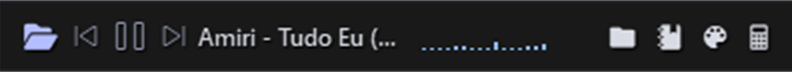
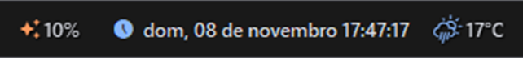
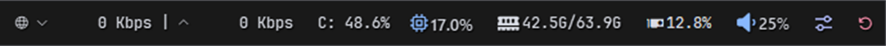

# Yasb-Pinho

Minha barra de status para Windows, feita com o [YASB](https://github.com/amnweb/yasb) (*Yet Another Status Bar*).
Escura, limpa, toda em português, com monitoramento do sistema, mídia, clima e atalhos.


> Este guia foi escrito para quem **nunca mexeu com o YASB**. Siga os passos na ordem e a barra vai funcionar.
> Se algo der errado, veja [Solução de problemas](docs/problemas.md).

---

## O que tem na barra

**Lado esquerdo**



| | Widget | O que faz |
|---|---|---|
| 📂 | **Menu inicial** | Atalhos para as suas pastas, Configurações e Gerenciador de Tarefas |
| ⏯️ | **Mídia** | Música/vídeo tocando agora, com anterior, play/pause e próxima |
| 〰️ | **Visualizador de áudio** | Barrinhas que dançam com o som (somem quando está em silêncio) |
| 🚀 | **Aplicativos** | Botões para abrir seus programas favoritos |

**Centro**



| | Widget | O que faz |
|---|---|---|
| 🕐 | **Relógio** | Data e hora; clique para abrir o calendário com feriados do Brasil |
| ⛅ | **Clima** | Temperatura atual; clique para ver a previsão hora a hora |

**Lado direito**



| | Widget | O que faz |
|---|---|---|
| ✨ | **Claude Usage** | Uso dos limites do Claude Code (opcional) |
| 🌐 | **Rede** | Velocidade de download e upload |
| 💽 | **Disco** | Uso do disco C:; clique para ver todos os discos |
| 🧠 | **CPU / Memória / GPU** | Uso do processador, da RAM e da placa de vídeo, com gráficos ao clicar |
| 🔊 | **Volume** | Volume geral e por aplicativo |
| 🎛️ | **Central de controle** | Não perturbe, modo escuro, captura de tela, áudio e plano de energia |
| ⏻ | **Energia** | Reiniciar e desligar |

A lista completa, com o que cada widget precisa e como ligar os que vêm desligados, está em [docs/widgets.md](docs/widgets.md).

---

## O que você precisa

- **Windows 10 ou 11**
- **YASB v2.0.8 ou mais novo**
- **Fonte JetBrainsMono Nerd Font** (desenha os ícones da barra)
- **Fonte Segoe Fluent Icons**: já vem no Windows 11. No Windows 10, baixe no [site da Microsoft](https://learn.microsoft.com/pt-br/windows/apps/design/style/segoe-fluent-icons-font).

---

## Instalação passo a passo

### 1. Instale o YASB e a fonte

Abra o **PowerShell** (aperte `Win`, digite *PowerShell* e dê Enter), cole o comando abaixo e aperte Enter:

```powershell
winget install amn.yasb DEVCOM.JetBrainsMonoNerdFont
```

Quando terminar, **abra o YASB uma vez** pelo menu Iniciar. Isso cria a pasta de configuração. Ele vai aparecer com o visual padrão, e é normal.

### 2. Baixe este projeto

Nesta página, clique no botão verde **Code**, depois em **Download ZIP**. Extraia o ZIP em qualquer lugar (ex.: na Área de Trabalho).

### 3. Abra a pasta de configuração do YASB

Aperte `Win + R`, cole o texto abaixo e dê Enter:

```
%USERPROFILE%\.config\yasb
```

> 💡 Já existem arquivos aí? Faça uma cópia deles em outro lugar antes de continuar, para poder voltar atrás.

### 4. Copie os arquivos

Da pasta que você extraiu, copie estes três arquivos para a pasta aberta no passo 3, substituindo os que já existem:

- `config.yaml`
- `styles.css`
- `.env.example`

### 5. Renomeie `.env.example` para `.env` ⚠️ *(o passo que mais dá errado)*

O YASB só lê um arquivo chamado **exatamente** `.env`. Se o nome ficar `env.txt`, `.env.txt` ou `.env.example`, o clima e os atalhos de pasta não funcionam.

1. No Explorador de Arquivos, clique em **Exibir → Mostrar → Extensões de nomes de arquivos**, para ver o nome completo.
2. Clique com o botão direito em `.env.example` → **Renomear** → apague tudo e escreva `.env`.
   - Se o Windows reclamar, escreva `.env.` (com um ponto no final): ele remove o ponto sozinho.

<details>
<summary>Prefere fazer pelo PowerShell?</summary>

```powershell
cd "$env:USERPROFILE\.config\yasb"
Rename-Item .env.example .env
```
</details>

### 6. Recarregue o YASB

No PowerShell:

```powershell
yasbc reload
```

Pronto! A barra nova deve aparecer. Agora faça os ajustes abaixo para ela ficar com a sua cara.

---

## Primeiros ajustes

Abra os arquivos com qualquer editor de texto (o Bloco de Notas serve; o [VS Code](https://code.visualstudio.com/) é melhor porque colore o código). Ao salvar, o YASB aplica as mudanças na hora.

### Clima (o mais importante)

1. Crie uma conta grátis em [weatherapi.com](https://www.weatherapi.com/) e copie a **API Key** que aparece no painel.
2. No arquivo `.env`, troque `cole_sua_chave_aqui` pela sua chave:
   ```
   WEATHERAPI_KEY=abc123suachaveaqui
   ```
3. No `config.yaml`, procure por `location: "Joinville"` e troque pela sua cidade.
4. Rode `yasbc reload` (o `.env` só é lido quando o YASB inicia).

> Não quer criar conta? Use o widget **Open-Meteo**, que não precisa de chave. Veja [docs/widgets.md](docs/widgets.md#clima-sem-chave).

### Seus aplicativos

No `config.yaml`, procure por `app_list:` e troque os caminhos pelos programas instalados no seu PC.
Para achar o caminho, clique com o botão direito no atalho do programa → **Abrir local do arquivo**.

### Suas pastas

No `.env`, troque `SeuUsuario` pelo seu nome de usuário do Windows nas linhas `Downloads=` e `Clipes=`.

### Ligar e desligar widgets

No `config.yaml`, em `widgets:` (dentro de `bars:`), cada widget é uma linha. Coloque um `#` no começo para **desligar** ou tire o `#` para **ligar**:

```yaml
"media",        # ligado
#"wallpapers",  # desligado
```

Mais personalizações (cores, ícones, monitor, posição) estão em [docs/personalizacao.md](docs/personalizacao.md).

---

## Documentação

| Guia | Para quê |
|---|---|
| [docs/widgets.md](docs/widgets.md) | Todos os widgets: o que fazem, o que precisam, como ativar |
| [docs/personalizacao.md](docs/personalizacao.md) | Cores, transparência, ícones, monitor, posições |
| [docs/problemas.md](docs/problemas.md) | Quando algo não funciona |
| [CHANGELOG.md](CHANGELOG.md) | O que mudou em cada versão |

---

## Créditos

- [YASB](https://github.com/amnweb/yasb), por amnweb e contribuidores: o programa que faz tudo funcionar.
- [WINchester / winchestercanal/Yasb](https://github.com/winchestercanal/Yasb): usado como referência de estrutura na primeira versão.

## Licença

[MIT](LICENSE): use, copie e modifique à vontade, mantendo o aviso de autoria.
